<div align="center">

# Restaurant POS System (Next.js, React, TypeScript)

A restaurant point of sale that runs entirely in the browser.<br>
Take dine-in and takeaway orders, split the bill between cash and card, print receipts, send tickets to a kitchen display, and manage the menu, staff, tables, discounts and sales reports from one back office.

**[Live demo](https://kianis534.github.io/restaurant-pos-system-nextjs/)** · sign in with `admin001` / `admin123`

[](https://github.com/Kianis534/restaurant-pos-system-nextjs/actions/workflows/ci.yml)
[](https://github.com/Kianis534/restaurant-pos-system-nextjs/actions/workflows/pages.yml)
[](LICENSE)


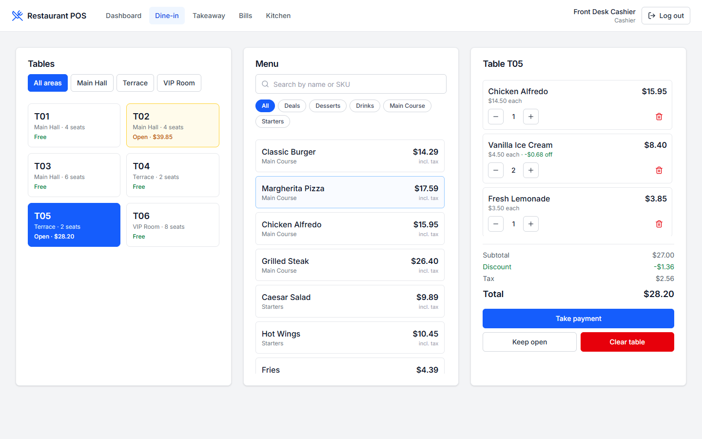

</div>

---

## Table of contents

- [Overview](#overview)
- [Screenshots](#screenshots)
- [Features](#features)
- [Tech stack](#tech-stack)
- [Project structure](#project-structure)
- [Getting started](#getting-started)
- [Configuration and your own passwords](#configuration-and-your-own-passwords)
- [How it works](#how-it-works)
- [Data API reference](#data-api-reference)
- [Data model (storage schema)](#data-model-storage-schema)
- [Page map](#page-map)
- [Testing and quality checks](#testing-and-quality-checks)
- [Deploying](#deploying)
- [Troubleshooting](#troubleshooting)
- [Security notes](#security-notes)
- [Roadmap](#roadmap)
- [Contributing](#contributing)
- [Disclaimer](#disclaimer)
- [Author](#author)
- [License](#license)

---

## Overview

This is a full point-of-sale app for a small restaurant or cafe. There are three kinds of staff account, and each one lands on its own screen:

| Role | What they do |
|---|---|
| **Cashier** | Opens tables, rings up dine-in and takeaway orders, puts orders on hold, takes cash / card / split payments, prints or downloads receipts, looks up old bills. |
| **Kitchen** | Watches the kitchen display. Every paid order shows up as a ticket that moves from *pending* to *preparing* to *ready* to *served*. |
| **Admin** | Everything a cashier can do, plus the back office: menu items and deals, categories, staff accounts, tables and areas, discounts, tax and receipt settings, sales reports, CSV export, backup and restore. |

There is no backend. All data lives in the browser's `localStorage`, so the app builds to plain static files and runs on GitHub Pages, Netlify, an S3 bucket or a USB stick with a tiny web server. That makes it easy to try and easy to study, and it also sets clear limits, which the [security notes](#security-notes) explain.

It started as a Web Engineering semester project and has since been rebuilt, tested and documented so that anyone can run it, read it or build on it.

## Screenshots

| | |
|---|---|
| 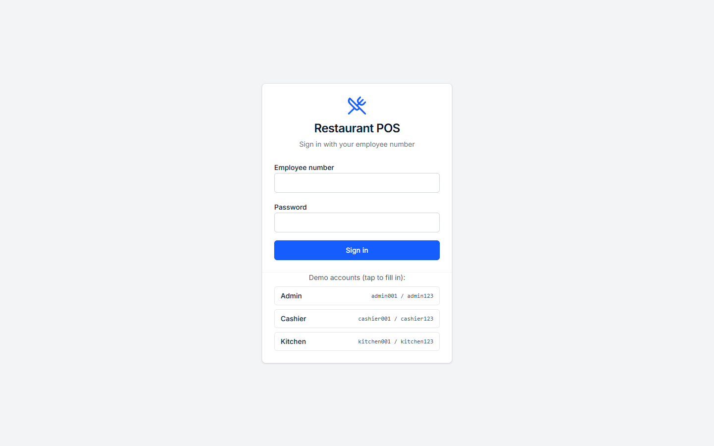 | 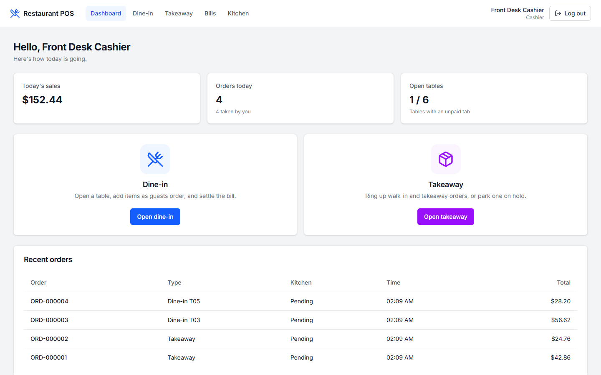 |
| **Sign in.** One tap fills in a demo account. | **Cashier dashboard.** Today's sales, open tables, recent orders. |
| 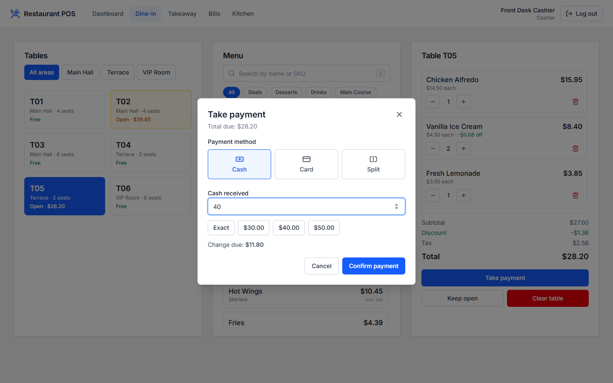 | 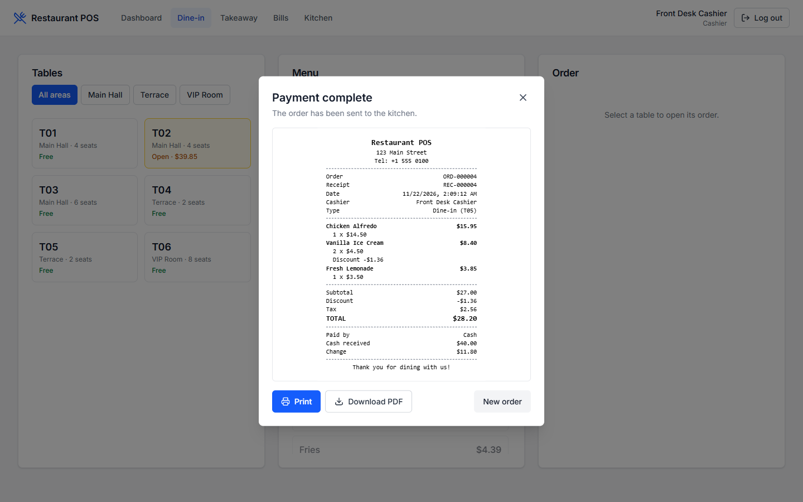 |
| **Payment.** Cash with change, card, or split. | **Receipt.** Print it (80 mm thermal layout) or save a PDF. |
| 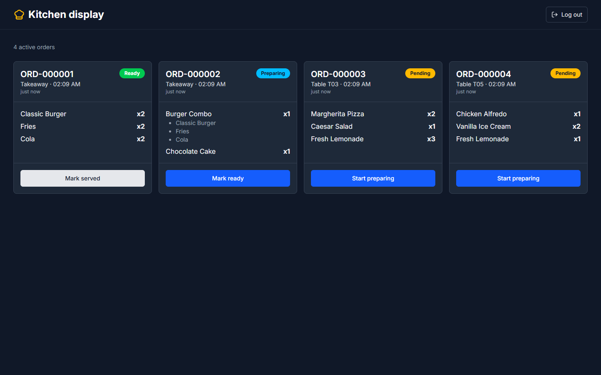 | 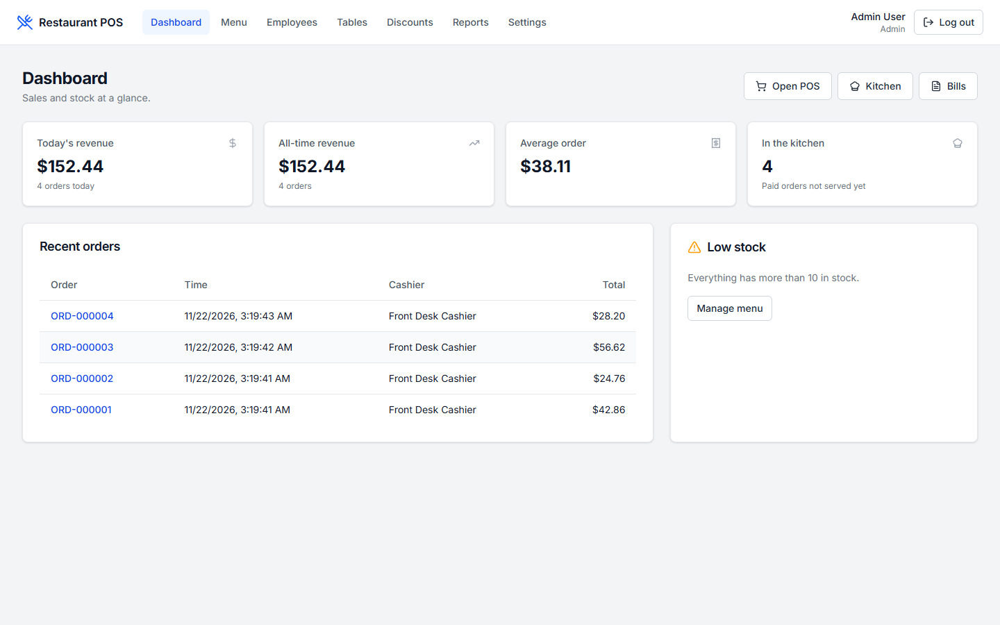 |
| **Kitchen display.** Tickets update live across tabs. | **Admin dashboard.** Revenue, kitchen queue, low stock. |
| 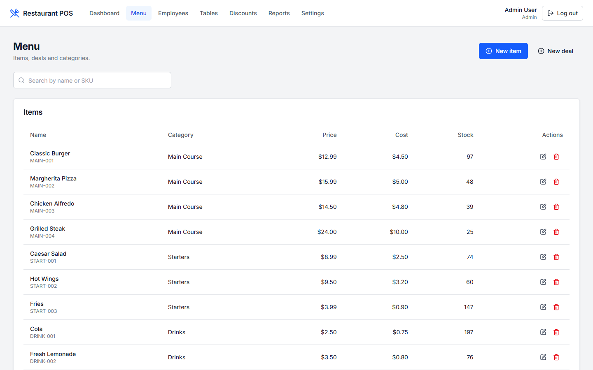 | 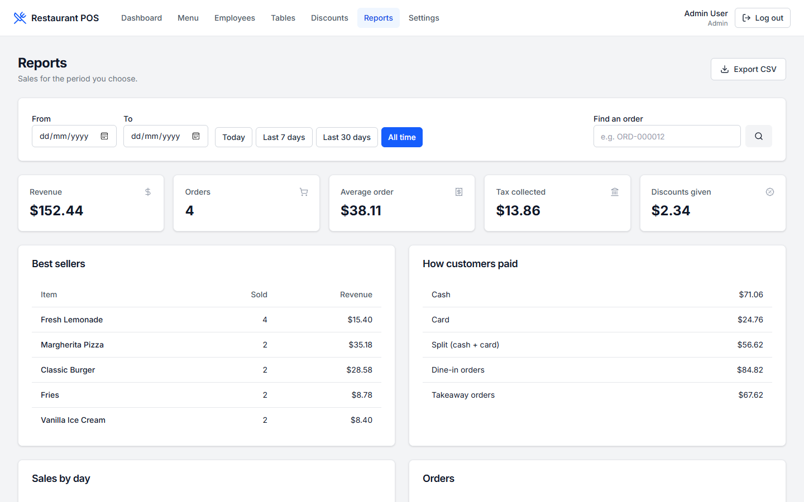 |
| **Menu.** Items, deals and categories. | **Reports.** Date ranges, best sellers, CSV export. |

On a phone the POS stacks into one column and a bar at the bottom keeps the running total in reach:

| | | |
|---|---|---|
| 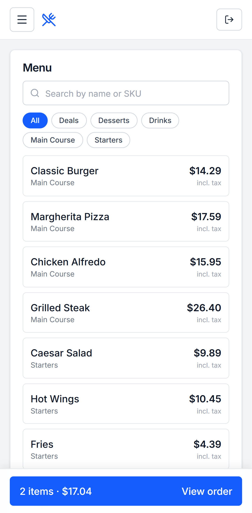 | 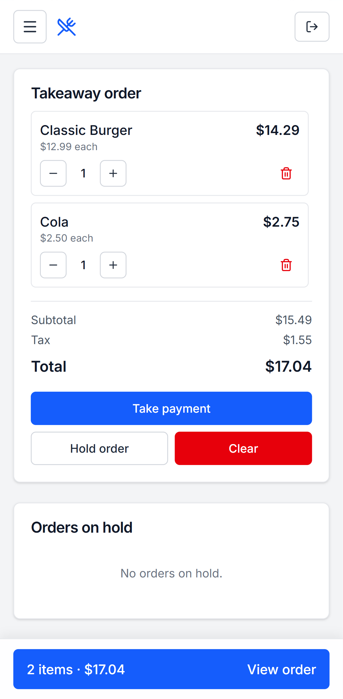 | 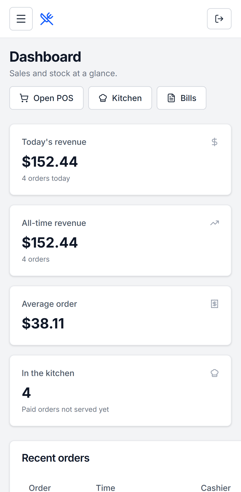 |

## Features

**Point of sale**
- Dine-in by table, filtered by area (Main Hall, Terrace, ...). A table's order is saved as you go, so switching tables or reloading the page never loses it. Tables with an unpaid tab are highlighted with their running total.
- Takeaway orders, with any number of orders parked on hold and resumed later.
- Menu search by name or SKU and category filter chips.
- Live prices that already include discounts and tax, with the original price struck through when a discount applies.
- Stock checks: sold-out items are disabled, quantities can't go past what's in stock, and stock is checked again at payment.
- Deals (combos) that take one of each bundled item out of stock.
- Payments by cash (with quick amounts and change due), card, or split between both. Split amounts balance each other automatically and must add up to the total.
- Receipts with order number, table, cashier, discounts, tax and payment details. Print them (only the receipt prints, sized for an 80 mm roll) or download a real text PDF.
- Bills history with search, open any old receipt to reprint it.

**Kitchen display**
- Every paid order becomes a ticket with its items (deal contents listed underneath), table or takeaway, and how long ago it came in. The waiting time turns red after 15 minutes.
- Updates instantly when an order is paid in another tab on the same device.

**Back office (admin)**
- Dashboard with today's and all-time revenue, average order, orders still in the kitchen, recent orders and low-stock alerts.
- Menu items with price, cost, stock, SKU, category and description, plus a live "customers pay ..." preview that includes tax.
- Deals built from existing items, showing how much the customer saves.
- Categories and table areas, with sensible clean-up when one is deleted.
- Staff accounts with roles (admin, cashier, kitchen), unique employee numbers and hashed passwords. You can't delete yourself or the last admin.
- Discounts by percentage for the whole menu, one category or one item, with start and end dates. The best matching discount wins; discounts don't stack.
- Settings for the tax rate, tax-free items, and the receipt header and footer.
- Reports for any date range: revenue, order count, average order, tax collected, discounts given, best sellers, payment and order-type breakdown, sales by day, order lookup by number, and CSV export.
- Backup to a JSON file, restore from it, or reset to the demo data.

**Under the hood**
- Builds to static files (`next build` with `output: 'export'`), so there's no server to run or pay for.
- Works under a sub-path such as `https://<user>.github.io/<repo>/`.
- Data from older versions of the app is upgraded automatically on first load, including hashing any plain-text passwords it finds.
- Responsive from phones to wide screens, keyboard accessible dialogs, labelled form fields.

## Tech stack

| Area | Tools |
|---|---|
| Framework | [Next.js 16](https://nextjs.org) (App Router, static export) with the React Compiler |
| UI | [React 19](https://react.dev), [Tailwind CSS 4](https://tailwindcss.com), [Radix UI](https://www.radix-ui.com) dialog, [lucide-react](https://lucide.dev) icons, [react-select](https://react-select.com) |
| Language | TypeScript 5 (strict) |
| Data | Browser `localStorage` behind one typed service (`src/lib/storage.ts`) |
| Passwords | PBKDF2-SHA256, 100,000 iterations, random salt, via [@noble/hashes](https://github.com/paulmillr/noble-hashes) |
| Receipts | [jsPDF](https://github.com/parallax/jsPDF) for PDF, CSS print styles for printing |
| Tests | [Vitest](https://vitest.dev) unit tests, [Playwright](https://playwright.dev) end-to-end tests on desktop and phone viewports |
| Quality | ESLint (Next.js core-web-vitals + TypeScript rules), `tsc --noEmit`, link and script checkers |
| CI / hosting | GitHub Actions, GitHub Pages |

## Project structure

```
restaurant-pos-system-nextjs/
├── .github/workflows/
│   ├── ci.yml                  # lint, types, unit tests, build, e2e, sub-path build
│   └── pages.yml               # builds and deploys the demo to GitHub Pages
├── docs/screenshots/           # README images (npm run screenshots regenerates them)
├── e2e/                        # Playwright end-to-end tests
├── scripts/
│   ├── capture-screenshots.mjs # drives the app and saves the README screenshots
│   ├── check-links.mjs         # broken links, anchors and root-absolute paths
│   ├── check-scripts.mjs       # package.json scripts exist, parse, and match this README
│   ├── fix-export-segments.mjs # post-build fix for a Next.js export bug on Windows
│   └── hash-password.mjs       # makes a password hash for the env file
├── src/
│   ├── app/                    # one folder per route (see the page map)
│   │   ├── admin/              # back office
│   │   ├── cashier/            # POS screens and bills
│   │   ├── kitchen/            # kitchen display
│   │   ├── login/  unauthorized/  not-found.tsx
│   │   ├── layout.tsx          # fonts, metadata, AuthProvider
│   │   └── globals.css         # Tailwind, print styles
│   ├── components/
│   │   ├── admin/              # forms and the order details panel
│   │   ├── auth/withAuth.tsx   # role guard for pages
│   │   ├── layout/             # app shell and role-specific navigation
│   │   ├── pos/                # menu list, cart, payment, receipt
│   │   └── ui/                 # buttons, inputs, cards, tables, dialogs
│   ├── contexts/AuthContext.tsx
│   ├── hooks/                  # useStoredData (reactive storage reads), usePosCart
│   ├── lib/                    # all business logic, framework-free and unit tested
│   │   ├── storage.ts          # the only code that touches localStorage
│   │   ├── pricing.ts          # discounts, tax, totals
│   │   ├── inventory.ts        # stock rules, deals
│   │   ├── checkout.ts         # payment validation, order + receipt creation
│   │   ├── password.ts         # hashing and verification
│   │   ├── reports.ts          # summaries and CSV export
│   │   ├── receipt.ts          # receipt layout and PDF
│   │   ├── validation.ts       # form rules
│   │   ├── seed.ts             # demo data
│   │   └── config.ts / format.ts / utils.ts
│   └── types/index.ts          # shared data types
├── tests/                      # Vitest unit tests
├── .env.example                # every setting, documented
├── next.config.ts              # static export, base path, trailing slashes
├── playwright.config.ts
└── vitest.config.mts
```

## Getting started

### Prerequisites

- [Node.js](https://nodejs.org) 22.12 or newer (the current LTS is fine) and npm
- Git

No database, API keys or accounts are needed.

### Run it locally

1. Clone the repository and install dependencies:

   ```bash
   git clone https://github.com/Kianis534/restaurant-pos-system-nextjs.git
   ```

   ```bash
   cd restaurant-pos-system-nextjs
   ```

   ```bash
   npm install
   ```

2. Optional: copy the example settings and adjust them (currency, app name, your own passwords). The app runs fine without this step.

   ```bash
   cp .env.example .env.local
   ```

3. Start the development server:

   ```bash
   npm run dev
   ```

4. Open http://localhost:3000 and sign in with one of the demo accounts:

   | Role | Employee number | Password |
   |---|---|---|
   | Admin | `admin001` | `admin123` |
   | Cashier | `cashier001` | `cashier123` |
   | Kitchen | `kitchen001` | `kitchen123` |

   To see the kitchen display react in real time, sign in as a cashier in one tab and open `/kitchen` in another (as admin or kitchen) on the same browser.

### Production build

```bash
npm run build
```

This writes a static site to `out/`. Preview it with:

```bash
npm start
```

`npm start` serves `out/` on http://localhost:3000. The exported files have to be served over HTTP; opening `out/index.html` straight from disk won't work, because Next.js loads its scripts from `/_next/...`.

### All npm scripts

| Command | What it does |
|---|---|
| `npm run dev` | Development server with hot reload |
| `npm run build` | Static export to `out/` (runs `scripts/fix-export-segments.mjs` afterwards) |
| `npm start` | Serves `out/` on port 3000 |
| `npm run lint` | ESLint |
| `npm run typecheck` | TypeScript, no output |
| `npm test` | Unit tests (Vitest) |
| `npm run test:watch` | Unit tests in watch mode |
| `npm run test:e2e` | End-to-end tests against `out/` (build first) |
| `npm run check:links` | Links and anchors in the docs, root-absolute paths in `src/` |
| `npm run check:site` | Every link and asset in the built `out/` folder |
| `npm run check:scripts` | npm scripts point at real files and match this README |
| `npm run hash-password -- "..."` | Prints a password hash for `.env.local` |
| `npm run screenshots` | Regenerates `docs/screenshots/` from a running build |

## Configuration and your own passwords

All settings are optional `NEXT_PUBLIC_*` environment variables, read at build time. Put them in `.env.local` (git-ignored) or set them in your host's build settings. [`.env.example`](.env.example) lists every one with comments.

| Variable | Default | What it does |
|---|---|---|
| `NEXT_PUBLIC_APP_NAME` | `Restaurant POS` | Name in the header, on the sign-in page and at the top of new receipts |
| `NEXT_PUBLIC_CURRENCY` | `USD` | ISO 4217 code used to format prices (`PKR`, `EUR`, `GBP`, ...) |
| `NEXT_PUBLIC_LOCALE` | `en-US` | Locale for numbers and dates (`en-PK`, `de-DE`, ...) |
| `NEXT_PUBLIC_BASE_PATH` | *(empty)* | Sub-folder the site is served from, e.g. `/restaurant-pos-system-nextjs` on GitHub Pages |
| `NEXT_PUBLIC_ADMIN_PASSWORD_HASH` | *(demo hash)* | Replaces the `admin001` demo password |
| `NEXT_PUBLIC_STAFF_PASSWORD_HASH` | *(demo hashes)* | Replaces the `cashier001` and `kitchen001` demo passwords |
| `NEXT_PUBLIC_SHOW_DEMO_ACCOUNTS` | `true`, or `false` once you set a hash | Show the demo logins on the sign-in page |

An invalid currency or locale falls back to USD / en-US instead of breaking the app.

### Bring your own passwords

The app has no third-party services, so there are no API keys to add. The only secrets are staff passwords, and the demo ones are public by design. If you deploy a copy for anything other than a demo, replace them. There are two ways:

**Option 1: change them in the app.** Sign in as `admin001`, open **Employees**, edit each account and set a new password. Add your own staff accounts and delete the demo ones you don't need. This only affects the browser you do it in, because each browser keeps its own data.

**Option 2: build your own passwords in.** Every new browser then starts with your passwords instead of the demo ones.

1. Generate a hash for each password (the password itself never goes in a file):

   ```bash
   npm run hash-password -- "a long passphrase for the admin"
   ```

   It prints something like `pbkdf2-sha256:100000:<salt>:<hash>`.

2. Put the hashes in `.env.local`, or in your host's environment settings:

   ```
   NEXT_PUBLIC_ADMIN_PASSWORD_HASH=pbkdf2-sha256:100000:...
   NEXT_PUBLIC_STAFF_PASSWORD_HASH=pbkdf2-sha256:100000:...
   ```

   For the GitHub Pages demo, add them as repository variables instead, under **Settings → Secrets and variables → Actions → Variables**, named `ADMIN_PASSWORD_HASH` and `STAFF_PASSWORD_HASH`. [`pages.yml`](.github/workflows/pages.yml) passes them to the build. `APP_NAME`, `CURRENCY` and `LOCALE` work the same way.

3. Rebuild (`npm run build`). The demo-account hint disappears from the sign-in page on its own.

Hashes only apply when a browser has no data yet, or after **Settings → Reset to demo data**. Browsers that already have data keep their existing accounts.

> Anything in a `NEXT_PUBLIC_` variable ends up in the JavaScript that every visitor downloads. That's fine for a salted PBKDF2 hash of a long passphrase, but never put a plain-text password, API key or token in one. Your `.env.local` is git-ignored; keep it that way.

## How it works

```
 Browser
 ┌──────────────────────────────────────────────────────────────┐
 │  Pages (src/app/**)  ──  withAuth(role)  ──  AppShell / nav   │
 │        │                                                       │
 │        ├── useStoredData(key, read)   reactive reads           │
 │        ├── usePosCart()               cart + checkout          │
 │        ▼                                                       │
 │  src/lib  (pure TypeScript, unit tested)                       │
 │   pricing · inventory · checkout · reports · validation        │
 │        │                                                       │
 │        ▼                                                       │
 │  StorageService (src/lib/storage.ts)                           │
 │   normalises every read, fires "pos:data-changed" on writes    │
 │        │                                                       │
 │        ▼                                                       │
 │  window.localStorage  (pos_users, pos_orders, ...)             │
 └──────────────────────────────────────────────────────────────┘
```

- **One door to the data.** Pages never call `localStorage` directly. `StorageService` reads and writes every key, runs each record through a normaliser (so a hand-edited or old record can't crash a screen), and fires a `pos:data-changed` event on every write.
- **Reactive reads.** `useStoredData()` wraps `useSyncExternalStore`. The static HTML renders an empty state, the browser swaps in real data right after hydration, and every screen re-reads when this tab or another tab changes something. That's how the kitchen display updates the moment a cashier takes a payment in another tab.
- **Pricing.** For each line: base price, minus the best active discount (rounded to the cent), plus tax on the discounted price unless the item is tax-free. Totals are sums of rounded lines, so the receipt always adds up.
- **Checkout.** Stock is re-checked against the latest saved data, the payment is validated, then the order and receipt are saved and stock is deducted in one go. The new order starts as *pending* for the kitchen.
- **Sign-in.** The employee number is matched case-insensitively and the password is checked against its PBKDF2 hash. Only the user's id is stored as the session; the account record and hash never leave the storage layer.
- **Static export.** Edit and detail pages use query strings (`/admin/products/edit/?id=...`) instead of `[id]` folders, because IDs only exist in the visitor's browser and can't be known at build time.
- **Upgrades.** A `pos_version` key records the data format. Data saved by the original version of this project (plain-text passwords, "sales" instead of discounts, a misnamed tax setting) is converted on first load.

## Data API reference

There is no HTTP API; the "API" is the typed `StorageService` in [`src/lib/storage.ts`](src/lib/storage.ts), exported as a shared `storage` instance. Tests create their own instance with an in-memory store.

| Method | Returns / does |
|---|---|
| `initialize()` | Loads demo data on first run, upgrades older data. Async (hashing). |
| `getUsers()` / `saveUsers(users)` | Staff accounts with password hashes |
| `getPublicUsers()` | Staff accounts without hashes, for the UI |
| `getProducts()` / `saveProducts(list)` | Menu items and deals |
| `getCategories()` / `saveCategories(list)` | Menu categories |
| `getDiscounts()` / `saveDiscounts(list)` | Percentage discounts |
| `getTables()` / `saveTables(list)` | Tables |
| `getAreas()` / `saveAreas(list)` | Table areas |
| `getOrders()` / `saveOrders(list)` / `updateOrder(id, patch)` | Paid orders |
| `getReceipts()` / `saveReceipts(list)` | Receipts |
| `nextOrderNumber()` | Next sequential number, e.g. `ORD-000042` |
| `getHeldTableOrders()` / `getHeldTableOrder(id)` / `saveHeldTableOrder(id, items)` / `clearHeldTableOrder(id)` | Open dine-in tabs |
| `getHeldTakeawayOrders()` / `saveHeldTakeawayOrders(list)` | Takeaway orders on hold |
| `getSettings()` / `saveSettings(settings)` | Tax rate, tax-free items, receipt text |
| `getSession()` / `setSession(session or null)` | Signed-in user id |
| `exportData()` / `importData(json)` | Full backup and restore (restore refuses files without a usable admin) |
| `loadDemoData()` / `resetToDemoData()` / `clearAll()` | Demo data and wiping |

The business rules sit next to it as plain functions, for example `unitPrice(product, ctx)`, `cartTotals(items)` and `discountPercentFor(product, discounts)` in `pricing.ts`, `availableToAdd(product, products, cart)` and `deductStock(products, cart)` in `inventory.ts`, `validatePayment(total, payment)` and `buildSale(input)` in `checkout.ts`, and `summarize(orders)` and `ordersToCsv(orders)` in `reports.ts`.

## Data model (storage schema)

Each collection is a JSON value under its own `localStorage` key. Shapes are defined in [`src/types/index.ts`](src/types/index.ts).

| Key | Type | Notes |
|---|---|---|
| `pos_version` | `number` | Data format version (currently `2`) |
| `pos_users` | `StoredUser[]` | `id, name, employeeNo, role, email, phone, passwordHash` |
| `pos_session` | `{ userId }` | Only the id of the signed-in user |
| `pos_products` | `Product[]` | `id, name, category, price, cost, quantity, sku?, description?, isDeal?, dealItems?` |
| `pos_categories` | `Category[]` | `id, name` |
| `pos_discounts` | `Discount[]` | `id, name, type ('all' / 'category' / 'item'), percent, startDate, endDate, target?` |
| `pos_tables` | `Table[]` | `id, name, area ('' means every area), capacity` |
| `pos_areas` | `Area[]` | `id, name` |
| `pos_orders` | `Order[]` | Items, `subtotal, discount, tax, total`, `type`, table, cashier, payment details, `kitchenStatus` |
| `pos_receipts` | `Receipt[]` | A snapshot of the order as printed |
| `pos_held_orders` | `Record<tableId, OrderItem[]>` | Open dine-in tabs |
| `pos_walkin_held_orders` | `OrderItem[][]` | Takeaway orders on hold |
| `pos_settings` | `Settings` | `taxRate` (fraction), `taxExemptProductIds`, `receiptHeader`, `receiptFooter` |

An `OrderItem` stores the per-unit `price`, `discount` and `tax` that applied at the time of sale plus the line `total`, so later price changes never rewrite history. Dates in discounts are local calendar days (`yyyy-mm-dd`, both ends inclusive); timestamps on orders are ISO 8601.

## Page map

Paths are relative to the site root (add the base path on GitHub Pages).

| Path | Who | What |
|---|---|---|
| `/` | everyone | Redirects to the right home screen or to sign-in |
| `/login/` | everyone | Sign in |
| `/unauthorized/` | signed in | Shown when a role opens a page it can't use |
| `/cashier/dashboard/` | cashier, admin | Today's sales, open tables, recent orders |
| `/cashier/dine-in/` | cashier, admin | Tables, menu and the table's order |
| `/cashier/takeaway/` | cashier, admin | Takeaway orders and orders on hold |
| `/cashier/bills/` | cashier, admin | Receipt history with search |
| `/cashier/bills/view/?id=` | cashier, admin | One receipt: print or PDF |
| `/kitchen/` | kitchen, cashier, admin | Kitchen display |
| `/admin/dashboard/` | admin | Back-office overview |
| `/admin/products/` | admin | Menu items, deals, categories |
| `/admin/products/new/`, `/admin/products/edit/?id=` | admin | Add or edit an item |
| `/admin/products/deals/new/`, `/admin/products/deals/edit/?id=` | admin | Add or edit a deal |
| `/admin/employees/`, `.../new/`, `.../edit/?id=` | admin | Staff accounts |
| `/admin/tables/`, `.../new/`, `.../edit/?id=` | admin | Tables and areas |
| `/admin/discounts/`, `.../new/`, `.../edit/?id=` | admin | Discounts |
| `/admin/reports/` | admin | Sales reports and CSV export |
| `/admin/settings/` | admin | Tax, receipt text, backup, restore, reset |

Any other path shows the not-found page.

## Testing and quality checks

```bash
npm run lint
```

```bash
npm run typecheck
```

```bash
npm test
```

**Unit tests** (`tests/`, Vitest) cover the business logic: rounding, discount dates and precedence, tax on discounted prices, tax-free items, cart totals, stock and deal rules, payment validation, order and receipt creation, password hashing (including a check that the shipped demo hashes really match the documented demo passwords), storage normalisation, upgrading data from the original version, backup and restore, report summaries, CSV formula-injection protection, receipt layout and form validation.

**End-to-end tests** (`e2e/`, Playwright) run the real static build in Chromium at a desktop size and on an emulated Pixel 7. They fail on any console error. They cover sign-in and role guards, a full takeaway sale through to the kitchen marking it served, a dine-in tab that survives a reload and then shows up in bills, discounts and tax-free items at the till, split-payment validation, held orders, creating menu items, discounts, staff and tables, the tax setting, reports, reset, every screen rendering without sideways scrolling, and the not-found page.

```bash
npm run build
```

```bash
npm run test:e2e
```

On Windows or macOS you can use a browser you already have instead of downloading Playwright's: `PW_CHANNEL=msedge` or `PW_CHANNEL=chrome` in front of the command. To test a deployed copy, set `E2E_BASE_URL` to its root URL (with the trailing slash).

**Checkers.** `npm run check:links` checks links and anchors in the docs and flags hard-coded root-absolute paths in `src/`. `npm run check:site` checks every link and asset in the built site, including the base path. `npm run check:scripts` makes sure every npm script points at something real and is documented here.

**CI** ([`.github/workflows/ci.yml`](.github/workflows/ci.yml)) runs all of the above on every push and pull request, plus a second build under a sub-path to catch anything that would break on GitHub Pages.

## Deploying

### GitHub Pages (what the demo uses)

[`.github/workflows/pages.yml`](.github/workflows/pages.yml) builds with `NEXT_PUBLIC_BASE_PATH=/<repository name>`, checks every link and publishes `out/` as a Pages artifact (no Jekyll step, so the `_next` folder is served as-is). To use it on your fork, go to **Settings → Pages** and set **Source** to **GitHub Actions**, then push to `main`.

### Any static host

Run `npm run build` and upload the `out/` folder. Set `NEXT_PUBLIC_BASE_PATH` only if the site lives in a sub-folder. Netlify, Vercel, Cloudflare Pages, S3 + CloudFront, nginx and Apache all work. Point the host's 404 page at `404.html` if it asks.

## Troubleshooting

| Problem | Fix |
|---|---|
| Blank page or 404s for `/_next/...` after deploying to a sub-folder | Set `NEXT_PUBLIC_BASE_PATH` to the sub-folder (with a leading slash, no trailing slash) and rebuild. |
| Opening `out/index.html` from disk shows nothing | Serve it over HTTP: `npm start`, or any static server. |
| On Windows, `npm run build` with `NEXT_PUBLIC_BASE_PATH=/name` in Git Bash fails with "Missing parameter name" | Git Bash rewrites values that start with `/` into Windows paths. Prefix the command with `MSYS_NO_PATHCONV=1`, use PowerShell, or put the value in `.env.local`. |
| On Windows, page-to-page navigation in the built site is slow and the console shows 404s for `__next.*.txt` | A Next.js 16 export bug on Windows writes those files into sub-folders. `npm run build` already runs `scripts/fix-export-segments.mjs` to fix it; if you call `next build` directly, run `node scripts/fix-export-segments.mjs` afterwards. |
| Demo logins stopped working | The data in this browser was changed (for example a password was edited). Use **Settings → Reset to demo data** as an admin, or clear this site's data in the browser. |
| My data is gone | Data lives in one browser on one device. Clearing site data, private windows and switching browsers all start fresh. Use **Settings → Download backup** regularly. |
| Prices show the wrong currency | Set `NEXT_PUBLIC_CURRENCY` and `NEXT_PUBLIC_LOCALE`, then rebuild. |
| PDF receipt shows `?` instead of a currency symbol | jsPDF's built-in fonts only cover Latin-1. Symbols like ₹ print as `?` in the PDF; printing from the browser shows them correctly. |
| Playwright says the browser isn't installed | Run `npx playwright install chromium`, or use `PW_CHANNEL=msedge` / `chrome`. |

## Security notes

Be clear about what this app is: a client-side POS that keeps its data in the browser. That's great for demos, learning and a single till, and it comes with limits.

What it does:
- Passwords are stored only as salted PBKDF2-SHA256 hashes (100,000 iterations) and compared in constant time. Plain-text passwords from older data are hashed and deleted on first load.
- The session stores only a user id, not the account or its hash.
- Every stored or imported record is validated and normalised before use, and a restore is refused if it would leave nobody able to sign in.
- CSV exports quote every cell and defuse values starting with `=`, `+`, `-` or `@`, so a product or staff name can't run as a spreadsheet formula.
- No secrets in the repository or its history, `.env*` files are git-ignored, and there are no third-party API calls at runtime.
- Dependencies are kept current; `npm audit` reports no known vulnerabilities at the time of writing.

What it can't do:
- **Role checks are a UI convenience, not a security boundary.** Anyone with access to the browser can open the developer tools and read or change `localStorage`, including making themselves an admin. Don't rely on roles to stop a determined person at the same device.
- **Data is not encrypted at rest** and isn't shared between devices.
- **Backups contain password hashes.** Keep them private.
- The demo accounts and their passwords are public. Replace them for real use (see [Bring your own passwords](#bring-your-own-passwords)).

For a multi-till restaurant or anything handling real money, put a server and a database behind the same UI (see the roadmap) so permissions are enforced on the server.

If you find a security problem, please open an issue without exploit details, or contact me through my GitHub profile.

## Roadmap

- Optional backend (Next.js route handlers or a small API with PostgreSQL) so several tills share data and permissions are enforced on the server
- Table transfers and merging, and splitting a bill by item or by guest
- Item modifiers and notes for the kitchen ("no onions", extra cheese)
- Refunds and voids with a reason, shown in reports
- Shift open/close with a cash drawer count
- Charts in the reports and gross profit using item cost
- Offline-first PWA install with a service worker
- Receipt printing to network thermal printers (ESC/POS)
- Translations (Urdu, Arabic) and right-to-left layout

## Contributing

Contributions are welcome.

1. Fork the repository and create a branch: `git checkout -b feature/short-description`
2. Make your change. Keep business logic in `src/lib` with unit tests, and keep pages thin.
3. Run the checks before opening a pull request:

   ```bash
   npm run lint && npm run typecheck && npm test
   ```

   ```bash
   npm run build && npm run check:site && npm run test:e2e
   ```

4. Open a pull request that explains what changed and why. Screenshots help for UI changes.

Bug reports and ideas are welcome as issues too.

## Disclaimer

This is a portfolio and learning project. It is not certified for fiscal or tax compliance in any country, it doesn't connect to real payment terminals, and it stores data only in the browser. Use it at your own risk. The menu items, prices, staff and restaurant details in the demo data are made up.

## Author

**Muhammad Abdullah Raja**, [@Kianis534](https://github.com/Kianis534)

If this project helped you, a star on the repository is appreciated.

## License

Released under the [MIT License](LICENSE).
